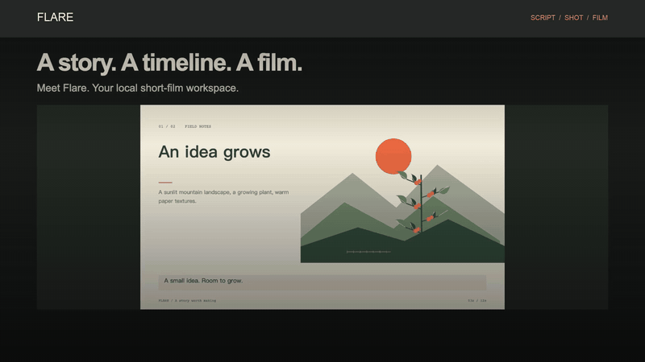
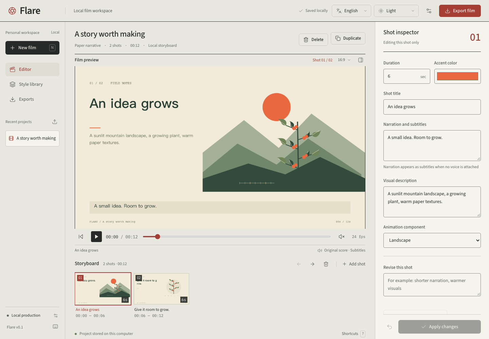

# Flare

**Turn a script into a short film. Keep control of every shot.**

Flare is an open-source, local short-film workspace. Write a script, shape the storyboard, edit individual shots, preview the result and export your film—without moving between separate tools.

**English** | [简体中文](README.zh-CN.md)

## See it in action

[](https://github.com/Hy-1990/Flare/blob/main/docs/assets/flare-launch.mp4)

_28-second preview · Click to open the full video with sound._

[Watch / download the MP4](https://raw.githubusercontent.com/Hy-1990/Flare/main/docs/assets/flare-launch.mp4)



The launch film passes through Flare's image-assisted renderer and export queue. It uses real interface captures and an original Flare-rendered example. Title cards and final sound/branding were prepared locally; see [production notes](docs/launch-film.md).

## What you can do

- **Plan and revise:** local script splitting, optional DeepSeek storyboarding and natural-language revision of one shot.
- **Direct each shot:** edit text, duration, composition, color and artwork; reorder, add, delete or undo individual shots.
- **Bring your visuals:** import images or generate images and narration through [DreamAPI](https://api.newportai.com/) with your own keys.
- **Explore styles:** 99 upstream style references, demo links and production guides. Eight have basic procedural renderers; the other 91 require images. Flare also includes three original procedural styles.
- **Preview and export:** landscape, portrait or square; 720p/1080p H.264 MP4 at 24 fps, AAC audio, SRT subtitles and project JSON.
- **Work locally:** persistent projects, duplication, deletion, immutable export snapshots, queueing and cancellation.
- **Choose your workspace:** English/Chinese, light/dark/system appearance and locally loaded fonts.

## Create with DreamAPI

[**DreamAPI**](https://api.newportai.com/) powers Flare’s optional image and narration generation. Generate visuals for individual shots and turn narration into speech, then edit and export the result in Flare.

Visit the [DreamAPI website](https://api.newportai.com/) to explore its playground and models, get your API key, and add it in Flare’s Settings. DeepSeek handles storyboarding and shot rewrites separately.

## Run locally

Requires **Node.js 22.13+** and **FFmpeg 7+** on your PATH. Validated on macOS Apple Silicon; Linux and Windows are not yet verified.

```bash
git clone https://github.com/Hy-1990/Flare.git
cd Flare
npm install
npm run setup:browser
npm run build
npm start
```

Open **http://127.0.0.1:4317**. The server listens on loopback only.

Optional: `npm run styles:sync` caches the pinned style guides and posters for offline use (about 35 MB). Without this step, references load on demand; upstream demo videos require internet access.

For development, use `npm run dev`. To change ports, use `PORT=4318 npm start`. Set `FLARE_DATA_DIR` to change the data location; the default is `.flare/`.

## Keys and costs

Local planning and procedural exports need no API key. Configure your own DeepSeek and DreamAPI keys in Settings, or use `DEEPSEEK_API_KEY` and `DREAMAPI_API_KEY` environment variables.

Keys are stored locally in `.flare/settings.json` with mode `600`, **not encrypted**. They are excluded from Git and project exports. Do not share that directory or its backups. Environment variables take precedence over saved settings.

DeepSeek planning/revision and DreamAPI generation use your provider balance. Image and narration submissions require confirmation. Failed or uncertain submissions are not automatically resubmitted as new paid jobs.

## Scope and limits

Flare is a short-film editor and renderer, not a full multi-track NLE or an automatic live-action filmmaking system. Local planning splits text; it does not understand or expand a script. Image-assisted styles animate supplied still images, not generated video clips. A style reference is not a promise to reproduce its demo automatically.

Projects support 1–16 shots and 3–120 seconds total. Project JSON references media rather than embedding it; copy the corresponding `.flare/media/` files when moving a project. Narration that exceeds its shot duration must be shortened or the shot extended.

Live-account validation covers DeepSeek Flash planning and single-shot revision, plus one DreamAPI image generated, saved and applied. Live narration is **not yet verified**. Automated provider tests use mocks.

## Verification

```bash
npm test
npm run build
npm run test:e2e
npm run test:projects
npm run test:ui
npm run format:check
```

Tests use isolated temporary projects and mock providers, not your paid account. The end-to-end suite exports real MP4 files and checks preview/export agreement, audio, subtitles, layouts and persistence. Optional `npm run test:styles` uses the synced reference cache.

## Architecture

| Path                  | Responsibility                                |
| --------------------- | --------------------------------------------- |
| `src/`                | React editor and preferences                  |
| `shared/film.js`      | Shared deterministic preview/export renderer  |
| `shared/model.js`     | Validated storyboards, timeline and subtitles |
| `server/store.js`     | Persistence, revisions and shot undo          |
| `server/providers.js` | DeepSeek and DreamAPI adapters                |
| `server/render.js`    | Chromium rendering and FFmpeg export queue    |

Model responses are validated data. Flare does not execute model-generated code.

## License and references

Flare's original application code is [MIT](LICENSE). The style catalog incorporates MIT metadata from [Lemo-Opuscar](https://github.com/lemomo-ai/lemo-opuscar), pinned at `3a7132b996be0241c1ea0ab180d519f06e6f10b6`; its copyright and license are retained.

Upstream guides and demos have **separate terms** and are not relicensed as Flare MIT. Guides use CC BY-NC 4.0 with upstream additional permissions for making your own films, including commercial films. Other commercial use of original/adapted guides in a product or service requires the upstream commercial license. Posters/demos use CC BY 4.0 subject to third-party exclusions. Read [THIRD_PARTY_NOTICES.md](THIRD_PARTY_NOTICES.md) before reuse.
