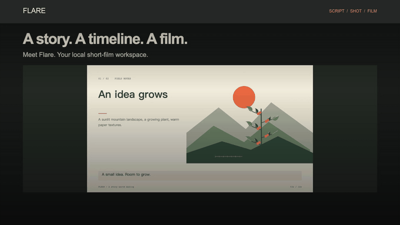
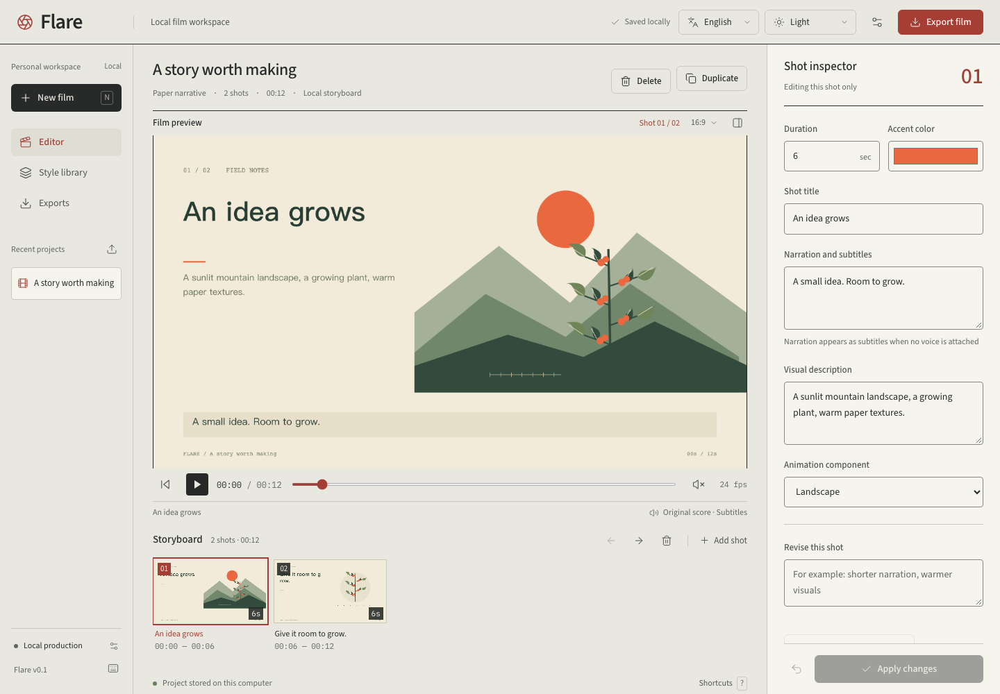

# Flare

[English](README.md) | **简体中文**

把故事做成影片。一个在本机运行的开源短片创作台。

Flare 将剧本、分镜、动画预览、镜头修改和视频导出放在一个工作空间里。DeepSeek、GPT 或 Claude 负责可选的 AI 分镜与单镜头修改，DreamAPI 负责可选的图片和配音生成；没有密钥时，也能用本地分镜和程序动画完成影片。

## 宣传视频

[](https://github.com/Hy-1990/Flare/blob/main/docs/assets/flare-launch.mp4)

_28 秒动图预览 · 点击打开带声音的完整视频。_

[观看／下载 MP4](https://raw.githubusercontent.com/Hy-1990/Flare/main/docs/assets/flare-launch.mp4)



宣传片使用真实界面和 Flare 原创渲染示例，经 Flare 的图片辅助渲染与导出流程完成；标题素材及最终配乐、品牌条在本地制作。详见[制作记录](docs/launch-film.md)。

## 当前版本能做什么

- 输入剧本，选择原项目的 99 种风格（15 类），或 Flare 原创的三种风格。按中文、英文、标识或用途搜索，查看原样片与制作规范。
- 8 种原项目风格有程序动画基础版；其余 91 种采用图片、运镜和字幕，每个镜头需要导入或生成图片后才能导出。
- 编辑镜头标题、旁白、画面描述、时长、颜色与动画组件；添加、删除、前后移动镜头。
- 撤销某个镜头的上一次修改，不回滚其他镜头。
- 实时播放与时间线定位，支持横屏、竖屏和方形构图。
- 界面支持中文／English；白天、黑夜或跟随系统外观。偏好保存在当前浏览器中，不修改剧本、素材、成片或原版规范。
- 界面字体采用 Source Sans 3、Noto Sans SC 和用于时间码的 IBM Plex Mono，均在本地加载。
- 导入本地图片，或确认后使用 DreamAPI 生成单镜头图片与中文配音。
- 可选 DeepSeek、GPT/OpenAI API、Claude/Anthropic API，或调用本机已登录的 Codex / Claude CLI 规划分镜、修改镜头。
- 「只换画面」锁定时长、旁白、配音与字幕时间。AI 改写先形成草稿；修改时长或旁白、撤销相关修改前均提示影响。
- 逐帧导出 720p / 1080p、24 fps 的 H.264 MP4，包含 AAC 音轨；同时下载 SRT 字幕和分镜 JSON。
- 支持项目复制、删除；项目自动持久化；每次导出使用独立快照。支持排队、取消和重新导出。

## 使用 DreamAPI 创作

[**DreamAPI**](https://api.newportai.com/) 为 Flare 提供可选的图片与配音生成能力。为单个镜头生成画面，将旁白转成语音，再回到 Flare 调整分镜并导出成片。

访问 [DreamAPI 官网](https://api.newportai.com/)，体验模型与在线 Playground、获取 API Key，然后填入 Flare 设置页。分镜规划和单镜头改写由所选文本模型提供。

## 安装与发布

macOS 与 Windows 的依赖安装、PowerShell 命令、升级和故障处理见[英文安装指南](docs/installation.md)。每次发布修复都必须升级版本并附英文 [Release Notes](docs/releasing.md)。发布前由 CI 检查双系统；具体结果以该版本的 Actions 记录为准。当前提供源码包，不提供 DMG / MSI 安装器。

## 运行

需要 **Node.js 22.13+、FFmpeg 7+**。macOS 与 Windows 由 CI 执行安装和导出检查；验收状态见对应版本的 Actions 记录。Linux 不在当前验证矩阵内。

```bash
git clone https://github.com/Hy-1990/Flare.git
cd Flare
npm ci
npm run setup:browser
npm run build
npm run styles:sync
npm start
```

打开 **http://127.0.0.1:4317**。应用只监听本机，不对局域网开放。

`npm run styles:sync` 将固定版本的 99 份制作规范和样片缩略图下载到 `.flare/style-library/`（约 35 MB，带 SHA-256 校验）。只需一次；未预同步时，详情页会按需获取，离线需预先缓存。原样片视频从原项目公开站点播放，不随 Flare 打包。

开发时使用 `npm run dev`。更换端口：`PORT=4318 npm start`。数据目录可通过 `FLARE_DATA_DIR` 指定。默认数据位于项目的 `.flare/`，不会被 Git 跟踪。

## 快速体验

1. 打开创作台，播放内置的「一粒咖啡的旅程」。打开声音可听程序配乐。
2. 修改一个镜头，点击「应用修改」，再试一次单镜头撤销。
3. 在风格库搜索「白板」，查看原样片和规范，应用程序基础版；再选「水彩」，为每镜导入图片，试试 9:16 构图。
4. 新建短片，使用「雨的一生」示例，选择本地分镜。
5. 导出 720p 成片，从导出记录下载 MP4、字幕与项目。
6. 在设置中填写自己的密钥，再测试真实 AI 分镜、单镜头修改、图片与配音。

## 密钥与费用

在设置中选择分镜与改写模型。API 模式填写密钥后可从下拉列表选择模型，也保留自定义模型入口；密钥留空保留已有值。支持 `DEEPSEEK_API_KEY`、`OPENAI_API_KEY`、`ANTHROPIC_API_KEY`、`DREAMAPI_API_KEY`，环境值优先。

CLI 模式先安装新版 Codex / Claude CLI 并在终端登录。Flare 从 PATH 或 `~/.local/bin` 检测程序，模型选择「CLI · 默认」即可，不需要填写模型名称。它在独立临时会话中调用模型，关闭工具并校验分镜数据，不把 Flare 嵌入编程助手。CLI 仍访问云端并消耗登录账户额度，不是离线模型。

密钥保存在 `.flare/settings.json`，**没有加密**。Unix 使用 `600` 权限，Windows 依赖当前账户的目录 ACL，请使用私有目录。密钥不会写入项目、字幕、导出快照或浏览器存储，接口只返回是否配置。不要共享 `.flare/settings.json` 或包含它的备份。移除界面中的密钥不改变外部环境变量。

- 本地分镜和程序动画导出不调用模型。
- AI 规划与改写使用所选 API 或 CLI 账户额度。
- DreamAPI 每次图片／配音提交前都有确认。生成失败不会自动重新付费提交。
- 查询中断后可恢复原任务；提交结果不确定时先到 DreamAPI 控制台核对，避免重复付费。
- 核对控制台后可在任务提示中标记已核对；再次生成仍需重新确认付费。因镜头已改变而未自动应用的素材，可以手动选用。
- 默认图片接口为 Nano Banana 2，默认配音为中文叙事音色。具体可用性和费用以服务商为准。

## 重要边界

**这是一版可运行的本地工具，不是任意剧本自动拍成写实电影的系统。**

- 本地分镜只按原文分段和关键词匹配组件，不会理解、扩写剧本，也不会假装 AI 生成成功。
- 原项目 99 种风格已补齐目录、参考与规范，**尚未逐个复刻原样片的完整动画引擎**。程序基础版覆盖白板、黑板、瑞士平面、像素 RPG、ASCII CRT、霓虹、交通线路图和蓝图；其余 91 种依赖具体图片素材。Flare 原创三种风格保留原有六类组件。
- 图片辅助模式不会根据风格名称自动得到对应画面。需要导入符合风格的素材，或使用选中风格的规范调用图片模型；缺图或部分缺图时拒绝导出。
- 规划分镜、单镜头改写、图片生成均会使用选中风格的规范。数据、地图、仪器等画面只有在你提供真实来源时才能作为事实；生成图片只能作示意。
- 模型输出只允许经过校验的分镜数据，不执行模型生成的任意代码。
- 总时长 3–120 秒、1–16 个镜头，每镜 1–30 秒。分镜规划的目标时长为 10–90 秒。
- 配音长于镜头时，导出会提示延长镜头，避免静默截断。改写旁白会移除旧配音关联。
- 配音与图片任务完成时，如果目标镜头已改变，保留素材但不覆盖新内容。
- 当前不含视频模型镜头生成、多人协作、云端托管或完整多轨剪辑。
- 项目 JSON 包含素材引用，**不内嵌素材文件**。带素材跨机器迁移时需同时复制 `.flare/media/`；只有本机存在的素材引用才允许导入。
- 浏览器自动播放需要用户操作；默认预览静音。导出的影片按项目的配乐开关和已附加配音合成。
- 重启后正在执行的导出标记为已中断，排队任务继续；已有成片不丢失。
- 素材下载拒绝本地与私有网络地址，并固定经过检查的目标 IP。遇到代理的 `198.18/15` Fake-IP DNS 时，会向 Google Public DNS 的固定 HTTPS 接口查询真实公共地址；只发送素材主机名，不发送密钥或素材正文。

真实账户已验证 DeepSeek Flash 分镜规划、单镜头改写，以及一张 DreamAPI 图片的生成、保存与应用。真实配音尚未验收；自动化测试中的图片／配音供应商使用模拟服务。Codex CLI 已在 macOS 实测通过 15 秒、3 镜头规划与单镜头改写；GPT/OpenAI API、Claude API、Claude CLI 仅通过模拟协议测试，Claude 真实账户待同事验收。详见[本地迭代验收](docs/local-iteration-2026-11-16.md)。

## 测试

```bash
npm test
npm run build
npm run test:e2e
npm run test:styles
npm run test:ui
npm run format:check
```

端到端测试启动独立的本地测试服务，使用临时数据和模拟供应商，不接触你的项目或付费账户。测试默认使用端口 4329，请确保可用。风格集成测试需先运行 `npm run styles:sync`，使用端口 4330；缓存未安装时，核心测试明确跳过两项来源集成测试。证据保存在 `docs/verification/`（截图与视频不提交 Git）。

## 结构

```text
src/                 React 创作台
shared/film.js       预览与导出共用的确定性动画
shared/model.js      分镜约束、本地规划、时间线与字幕
shared/score.js      原创程序配乐
server/app.js        本地 API、来源检查与文件访问
server/store.js      原子写入、版本检查、镜头撤销
server/providers.js  DeepSeek / DreamAPI 适配
server/render.js     Chromium 逐帧渲染、FFmpeg 合成、任务队列
tests/               状态、接口、安全边界与真实导出测试
```

## 来源与许可

受 [Lemo-Opuscar](https://github.com/lemomo-ai/lemo-opuscar) 的代码制片思路启发。Flare 的程序、动画引擎与工作流独立编写；风格目录元数据引入上游 MIT 内容，已保留版权和 [MIT 文本](licenses/lemo-opuscar-metadata-MIT.txt)。固定上游版本为 `3a7132b996be0241c1ea0ab180d519f06e6f10b6`。

原制作规范按 **CC BY-NC 4.0** 缓存，原样片与缩略图按 **CC BY 4.0（第三方内容除外）** 展示，不属于 Flare 的 MIT 许可。规范在详情中保留署名与许可；运行时会把相关段落用于选中风格的模型提示。上游另允许使用规范制作自己的商业影片及交付该片项目文件；把规范或改编内容放入商业产品／服务超出这一范围，需要上游商业许可。开源源码许可不改变这些边界，详见 [来源说明](THIRD_PARTY_NOTICES.md) 和固定版本的 [上游许可](https://github.com/lemomo-ai/lemo-opuscar/blob/3a7132b996be0241c1ea0ab180d519f06e6f10b6/LICENSE)。

界面打磨参考 [unslop by Damir Sokolovsky](https://heydamir.design/unslop) 的设计方法。依赖与说明见 [THIRD_PARTY_NOTICES.md](THIRD_PARTY_NOTICES.md)。Flare 原创源码采用 [MIT](LICENSE)。使用外部生成服务和自带素材时，请分别遵守相应条款。
